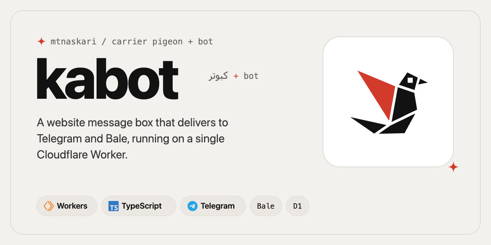

<picture>
  <source media="(prefers-color-scheme: dark)" srcset="https://raw.githubusercontent.com/mtnaskari/kabot/main/docs/assets/banner-dark.png">
  
</picture>

# kabot

[](https://github.com/mtnaskari/kabot/actions/workflows/ci.yml)
[](https://www.npmjs.com/package/kabot)
[](LICENSE)

A message box for your website that delivers to Telegram and Bale. It runs on a single Cloudflare Worker, so your own server never stores messages or talks to a messaging API.

**[Documentation](https://mtnaskari.github.io/kabot/)** · [Get started](https://mtnaskari.github.io/kabot/getting-started.html) · [HTTP API](https://mtnaskari.github.io/kabot/api.html) · [Security model](https://mtnaskari.github.io/kabot/security.html)

*Kabot* joins the Persian word *کبوتر* (*kabutar*, the carrier pigeon) with *bot*: it carries the notes people leave on your website to you.

## Why

Many servers cannot reach `api.telegram.org`, servers in Iran among them, and every site ends up rebuilding the same form, spam checks, storage and notifications. kabot moves all of that to one Worker. Your website embeds a script or makes one HTTPS call; the Worker validates the message, stores it in D1 and sends it to your chat, where buttons mark it read or archive it.

```
visitor ──► website ──► kabot Worker ──► Telegram / Bale ──► you
                            │
                            ▼
                            D1
```

## Features

- **Three ways to send:** a one-line widget, a React component, or `kabot/client` with an API key from Node.js, Workers, Deno or Bun.
- **Spam protection:** Turnstile, a honeypot, per-IP rate limits, a daily cap and an allow list per site.
- **Telegram and Bale**, separately or together, to private chats and groups.
- **An inbox in the chat:** mark read, archive and list unread messages without leaving Telegram.
- **One deployment, many sites**, each with its own origins, key and recipients.
- **Nothing is lost:** messages are stored before delivery, and failed deliveries are retried.
- **Private by design:** messages stay in your Cloudflare account and IP addresses are only kept as keyed hashes.

## Quick start

[](https://deploy.workers.cloudflare.com/?url=https://github.com/mtnaskari/kabot)

Or from a clone, with a bot token from [@BotFather](https://t.me/BotFather):

```bash
git clone https://github.com/mtnaskari/kabot && cd kabot
npm ci && npx wrangler login && npm run deploy

openssl rand -hex 32 | tee admin-token.txt | npx wrangler secret put ADMIN_TOKEN
openssl rand -hex 32 | npx wrangler secret put KABOT_SECRET
npx wrangler secret put TELEGRAM_BOT_TOKEN
```

Connect the bot and add your site:

```bash
export KABOT=https://kabot.<your-subdomain>.workers.dev
export ADMIN_TOKEN=$(cat admin-token.txt)

curl -X POST "$KABOT/admin/webhooks" -H "Authorization: Bearer $ADMIN_TOKEN"
curl -X POST "$KABOT/admin/sites" -H "Authorization: Bearer $ADMIN_TOKEN" -H "Content-Type: application/json" \
  -d '{"id": "my-site", "name": "My site", "allowedOrigins": ["https://example.com"]}'
```

Open the `pairing.links.telegram` link from the response and press **Start**. Then add the message box to your website:

```html
<script src="https://kabot.<your-subdomain>.workers.dev/widget.js" data-site="my-site" async></script>
```

The [getting started guide](https://mtnaskari.github.io/kabot/getting-started.html) explains every step.

## Documentation

The full documentation is at **[mtnaskari.github.io/kabot](https://mtnaskari.github.io/kabot/)**. Its sources are in [`docs/`](docs/index.md).

| Set up | Send messages | Operate | Reference |
| --- | --- | --- | --- |
| [Get started](docs/getting-started.md) | [Widget](docs/widget.md) | [Manage sites](docs/admin.md) | [HTTP API](docs/api.md) |
| [Telegram](docs/telegram.md) | [React](docs/react.md) | [Configuration](docs/configuration.md) | [Security model](docs/security.md) |
| [Bale](docs/bale.md) | [From a server](docs/server.md) | [Troubleshooting](docs/troubleshooting.md) | [Local development](docs/development.md) |

## Contributing

Contributions are welcome; see [CONTRIBUTING.md](CONTRIBUTING.md). To report a vulnerability, follow [SECURITY.md](SECURITY.md).

## License

[Apache-2.0](LICENSE). Copyright 2026 Matin Askari.
